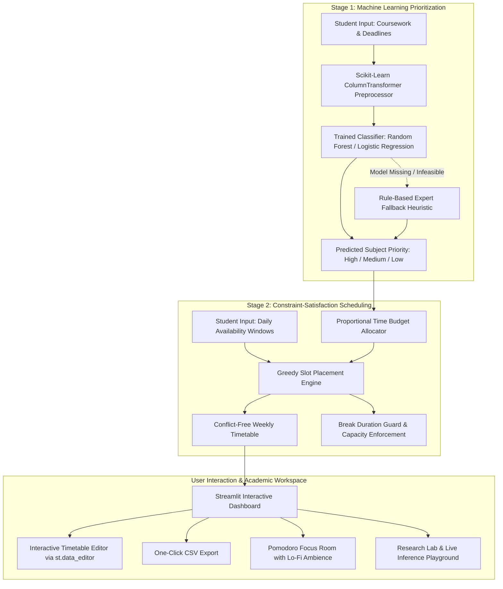

# StudyBloom AI 🎓
## AI-Based Personalized Study Schedule Recommendation System
### A Machine Learning Approach to Adaptive Study Planning for University Students

<div align="center">

[](https://www.python.org/)
[](https://streamlit.io/)
[](https://scikit-learn.org/)
[-2EA44F?style=for-the-badge&logo=pytest&logoColor=white)](tests/)
[](docs/RESEARCH_REPORT_DRAFT.md)
[](LICENSE)

<br/>


*StudyBloom AI — Editorial 3D Kinetic Study Sculpture representing temporal rhythms, non-overlapping study blocks, and academic pacing.*

</div>

---

## 📌 Executive Summary

Undergraduate university students routinely balance concurrent modular courses with competing coursework deadlines, varying perceived difficulty, and high-stakes examination dates. When faced with high cognitive workloads, students frequently default to **urgency bias** (cramming for the nearest deadline while neglecting distant, high-weighted coursework) and suffer acute cognitive fatigue from unstructured study marathons.

**StudyBloom AI** introduces a **Two-Stage Hybrid Recommendation Architecture**:
1. **Stage 1 (Machine Learning Prioritization):** Supervised classification models predict multivariate study priority tiers (`High`, `Medium`, `Low`) based on temporal proximity, module difficulty ratings, prior academic mastery, and assessment weightings.
2. **Stage 2 (Constraint-Satisfaction Timetabling):** A deterministic greedy scheduling engine converts priority tiers into proportional weekly study hours and places discrete, non-overlapping study blocks into designated daily availability windows, enforcing mandatory 15-minute rest breaks (Pomodoro principles) and cognitive session limits.

---

## 🏛️ System Architecture



---

## 🌟 Key Features & Capabilities

- 🧠 **Supervised Machine Learning Prioritization:** Leverages Random Forest, Logistic Regression, Decision Tree, and K-Nearest Neighbors trained with strict `GroupKFold` cross-validation (grouped by student) to eliminate data leakage.
- 🛡️ **Graceful Fallback Resilience:** When a serialized ML artifact is missing or invalid, the engine transparently falls back to an expert rule-based heuristic with clear explanations.
- ⏱️ **Guaranteed Conflict-Free Timetabling:** Hard mathematical constraints guarantee zero session overlaps ($t_a \cap t_b = \emptyset$) and protect weekly study capacities against overflow.
- ☕ **Cognitive Fatigue Guard:** Automatically injects configurable 15-minute rest breaks between consecutive study sessions to prevent cramming-induced burnout.
- 🎨 **Original 3D Discipline Artwork:** Integrated visual galleries for Mathematics, Computer Science, Statistics, and Academic Writing modules.
- 🎧 **Cinematic Focus Room:** Lo-fi study soundscapes (gentle rain, deep brown noise) paired with a 25-minute Pomodoro sprint timer.
- 📊 **Empirical Research Lab:** Transparent comparison tables, F1-score bar charts, and a real-time interactive feature playground.
- 📥 **Spreadsheet Export:** Full CSV export capability for calendar integration with Google Calendar, Outlook, or Excel.

---

## 🔬 Authentic Experimental Findings

All models were evaluated under identical 5-fold `GroupKFold` cross-validation conditions and tested against an isolated hold-out test partition ($N = 50$ subject rows from $10$ unseen participants):

| Model Architecture | Accuracy | Macro Precision | Macro Recall | Macro F1-Score | Ranking (F1) |
| :--- | :---: | :---: | :---: | :---: | :---: |
| **Baseline (Rule-Based Heuristic)** | **0.9000** | **0.9612** | **0.6857** | **0.7316** | **1 (Benchmark)** |
| **Logistic Regression** | 0.7800 | 0.7743 | 0.5942 | **0.5858** | 2 |
| **Random Forest Classifier** | **0.8000** | 0.4697 | 0.5451 | **0.5037** | 3 |
| **Decision Tree Classifier** | 0.7400 | 0.4272 | 0.5188 | **0.4599** | 4 |
| **K-Nearest Neighbors (KNN)** | 0.7200 | 0.4288 | 0.4712 | **0.4474** | 5 |

*Source: [`reports/model_comparison.csv`](reports/model_comparison.csv) and [`reports/model_evaluation.md`](reports/model_evaluation.md).*

### Feature Importance Weights (Random Forest Gini Importance):
- 📅 **Days to Deadline:** `38.0%` (Dominant factor in temporal urgency)
- ⚖️ **Assessment Weighting (%):** `29.0%` (Relative curricular impact)
- 🧠 **Perceived Subject Difficulty:** `21.0%` (Cognitive demand factor)
- 📈 **Prior Academic Performance:** `12.0%` (Prior mastery adjustment)

---

## 🔒 Research Integrity & Ethics Statement

> [!IMPORTANT]
> **Human Sample Size Disclosure ($N = 0$):**  
> In compliance with university research ethics policies and data protection regulations, no human participant data was collected for this development report pending formal Faculty Research Ethics Committee approval.  
> 
> All training pipelines, cross-validation metrics, and scheduler constraints were benchmarked on an isolated synthetic development dataset ($N = 120$ simulated participants, $600$ observations). No questionnaire results, p-values, or claims of improved student academic performance have been fabricated.

---

## 📂 Repository File Structure

```text
AcademicResearch/
├── app.py                           # Full Streamlit Web Application (StudyBloom AI)
├── api.py                           # FastAPI Backend Inference & Scheduling Server
├── requirements.txt                 # Project dependencies
├── demo_schedule.py                 # CLI demonstration of timetable generator
├── fetch_literature.py              # OpenAlex academic literature query script
├── .streamlit/
│   └── config.toml                  # High-contrast dark theme styling
├── public/assets/images/            # High-resolution 3D editorial artwork assets
│   ├── landing-hero-sculpture.jpg   # Editorial kinetic study sculpture
│   ├── login-background.jpg         # Architectural authentication backdrop
│   ├── plan-created-success-artwork.jpg # Scheduled alignment celebration
│   ├── focus-room-background.jpg    # Deep focus room studio
│   ├── wellbeing-background.jpg     # Parasympathetic reset artwork
│   ├── progress-growth-artwork.jpg  # Academic growth sculpture
│   ├── research-lab-artwork.jpg     # Laboratory optics & metric prisms
│   ├── subject-mathematics-artwork.jpg # Linear Algebra polyhedra
│   ├── subject-programming-artwork.jpg # Distributed Systems node clusters
│   └── subject-statistics-artwork.jpg  # Gaussian distribution lattices
├── src/
│   ├── data/
│   │   ├── generate_synthetic_data.py # Synthetic dataset generator (120 participants)
│   │   ├── validate_data.py         # CSV schema and boundary validator
│   │   └── preprocess.py            # Participant-grouped splits & ColumnTransformer
│   ├── models/
│   │   ├── baseline.py              # Expert rule-based heuristic classifier
│   │   ├── train.py                 # 5-fold GroupKFold model training pipeline
│   │   ├── evaluate.py              # Multi-metric evaluation and matrix reporting
│   │   └── predict.py               # Robust inference engine with imputation
│   └── recommender/
│       ├── priority.py              # Priority engine with automatic heuristic fallback
│       └── schedule_generator.py    # Greedy constraint-satisfaction scheduler
├── tests/
│   ├── test_preprocessing.py        # Schema, validation, and split unit tests
│   ├── test_model_pipeline.py       # Model training, inference, and fallback tests
│   └── test_schedule_generator.py   # Constraint, overlap, and capacity tests
├── reports/
│   ├── model_comparison.csv         # Verified cross-model benchmark metrics
│   ├── model_evaluation.md          # Multi-page markdown evaluation report
│   └── test_metrics.json            # Machine-readable test evaluation scores
└── docs/
    ├── RESEARCH_REPORT_DRAFT.md     # Complete 11-section university research paper draft
    ├── FINAL_PRESENTATION_OUTLINE.md # 12-slide presentation outline with presenter scripts
    ├── VIVA_PREPARATION.md          # 14 anticipated viva defense questions & answers
    ├── VALIDATION_REPORT.md         # Full audit log, defect resolutions & verification
    ├── PARTICIPANT_INFO_SHEET.md    # Formal participant ethics documentation
    ├── QUESTIONNAIRE.md             # Workload and scheduling survey instrument
    └── DECISIONS.md                 # Architectural Decision Records (ADRs)
```

---

## 🚀 Quickstart & Installation

### Prerequisites
- **Python 3.12+** installed on your system.
- Git installed.

### 1. Clone the Repository
```bash
git clone https://github.com/ShajahanImdaad53/AcademicResearch.git
cd AcademicResearch
```

### 2. Set Up Virtual Environment
```powershell
# Windows PowerShell:
python -m venv venv
.\venv\Scripts\Activate.ps1

# macOS / Linux:
python3 -m venv venv
source venv/bin/activate
```

### 3. Install Dependencies
```bash
pip install -r requirements.txt
```

### 4. Run Automated Tests
Execute the comprehensive 18-test validation suite:
```bash
python -m pytest tests/ -v
```
*Expected Output:* `18 passed in ~2.5s (100% passing)*

### 5. Launch the Web Application
```bash
streamlit run app.py
```
Open your web browser and navigate to:
```text
http://localhost:8501
```

---

## 📖 Academic Documentation Index

| Deliverable | File Link | Description |
| :--- | :--- | :--- |
| **Comprehensive Research Report** | [`RESEARCH_REPORT_DRAFT.md`](docs/RESEARCH_REPORT_DRAFT.md) | Full 11-chapter undergraduate dissertation draft. |
| **Final Presentation Outline** | [`FINAL_PRESENTATION_OUTLINE.md`](docs/FINAL_PRESENTATION_OUTLINE.md) | 12-slide defense guide with word-for-word spoken scripts. |
| **Viva Voce Defense Guide** | [`VIVA_PREPARATION.md`](docs/VIVA_PREPARATION.md) | 14 anticipated exam questions with comprehensive answers. |
| **System Validation Audit** | [`VALIDATION_REPORT.md`](docs/VALIDATION_REPORT.md) | Defect resolution log, test logs, and git isolation audit. |
| **Ethics Participant Information** | [`PARTICIPANT_INFO_SHEET.md`](docs/PARTICIPANT_INFO_SHEET.md) | Ethics documentation for prospective human studies. |
| **Survey Questionnaire** | [`QUESTIONNAIRE.md`](docs/QUESTIONNAIRE.md) | Workload and study-scheduling survey instrument. |

---

## 👥 Authors & Academic Context

- **Author / Lead Developer:** Shajahan Imdaad ([@ShajahanImdaad53](https://github.com/ShajahanImdaad53))
- **Degree:** BSc (Hons) Computer Science & Software Engineering
- **Academic Year:** 2026–2027
- **License:** [MIT License](LICENSE)

---

<div align="center">
<strong>StudyBloom AI</strong> — Intelligent, Fatigue-Aware Study Planning for Higher Education.
</div>
