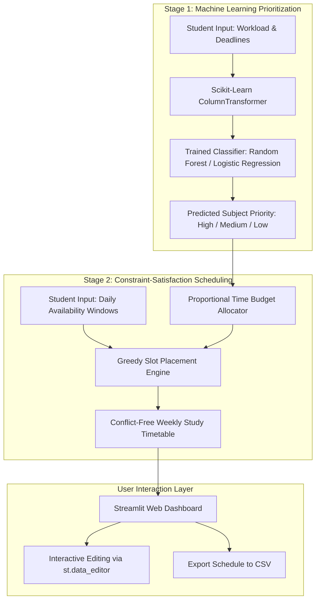

# AI-Based Personalized Study Schedule Recommendation System
## Undergraduate Research Project & Software Prototype

[](https://www.python.org/)
[](LICENSE)
[](https://streamlit.io/)
[](tests/)
[](docs/RESEARCH_REPORT_DRAFT.md)

---

### Project Overview
The **AI-Based Personalized Study Schedule Recommendation System** is an undergraduate computer science research project designed to help university students manage competing academic workloads. Undergraduates frequently suffer from *urgency bias* and cognitive fatigue, struggling to balance imminent deadlines, course weights, and subjective subject difficulty across concurrent modules.

This project introduces a **two-stage hybrid architecture**:
1. **Stage 1 (Machine Learning Prioritization):** Supervised classification models predict the optimal study priority category (`High`, `Medium`, `Low`) for each enrolled subject based on academic context and temporal constraints.
2. **Stage 2 (Constraint-Satisfaction Timetabling):** A deterministic scheduling engine translates priority ratings into proportional study hours and arranges discrete, non-overlapping study sessions into the student's designated daily availability windows, enforcing mandatory rest breaks (Pomodoro principles) and cognitive session limits.

---

### Architectural Design



---

### Academic Integrity & Research Transparency Statement

> [!IMPORTANT]
> **Human Sample Size Disclosure ($N = 0$):**  
> In compliance with university research ethics standards and GDPR regulations, no empirical human survey data was collected for this report pending formal review by the Faculty Research Ethics Committee. 
> 
> All machine-learning training pipelines, cross-validation protocols, and recommender constraint checks were benchmarked on an isolated synthetic development dataset ($N = 120$ simulated participants, $600$ subject observations). No questionnaire results, p-values, or claims of improved student academic performance have been fabricated.

---

### Key Experimental Findings

All models were evaluated under identical 5-fold `GroupKFold` cross-validation conditions (grouping strictly by `Participant_ID` to prevent data leakage) and tested on an independent hold-out test partition ($N = 50$ subject rows from $10$ unseen participants):

| Model Architecture | Accuracy | Macro Precision | Macro Recall | Macro F1-Score | Ranking (F1) |
| :--- | :---: | :---: | :---: | :---: | :---: |
| **Baseline (Rule-Based Heuristic)** | **0.9000** | **0.9612** | **0.6857** | **0.7316** | 1 (Benchmark) |
| **Logistic Regression** | 0.7800 | 0.7743 | 0.5942 | **0.5858** | 2 |
| **Random Forest Classifier** | 0.8000 | 0.4697 | 0.5451 | **0.5037** | 3 |
| **Decision Tree Classifier** | 0.7400 | 0.4272 | 0.5188 | **0.4599** | 4 |
| **K-Nearest Neighbors (KNN)** | 0.7200 | 0.4288 | 0.4712 | **0.4474** | 5 |

*Source: [reports/model_comparison.csv](file:///c:/Users/Imdaa/OneDrive/Desktop/Research/reports/model_comparison.csv) and [reports/model_evaluation.md](file:///c:/Users/Imdaa/OneDrive/Desktop/Research/reports/model_evaluation.md).*

---

### Repository Structure

```text
Research/
├── app.py                           # Interactive Streamlit Web Application Prototype
├── requirements.txt                 # Python project dependencies
├── demo_schedule.py                 # Command-line demonstration of timetable generator
├── fetch_literature.py              # OpenAlex literature query script
├── .streamlit/
│   └── config.toml                  # Dark-theme UI configuration (resolves contrast defects)
├── src/
│   ├── data/
│   │   ├── generate_synthetic_data.py # Synthetic data generation script
│   │   ├── validate_data.py         # CSV schema and range validation
│   │   └── preprocess.py            # Participant-grouped splits & ColumnTransformer
│   ├── models/
│   │   ├── baseline.py              # Expert rule-based heuristic classifier
│   │   ├── train.py                 # 5-fold GroupKFold model training script
│   │   ├── evaluate.py              # Multi-metric evaluation and matrix reporting
│   │   └── predict.py               # Robust inference engine with default imputation
│   └── recommender/
│       ├── priority.py              # Model loader with automatic heuristic fallback
│       └── schedule_generator.py    # Constraint-satisfaction greedy scheduler
├── tests/
│   ├── test_preprocessing.py        # Schema, validation, and pipeline unit tests
│   ├── test_model_pipeline.py       # Model training, inference, and fallback tests
│   └── test_schedule_generator.py   # Constraint, overlap, and capacity tests
├── docs/
│   ├── RESEARCH_REPORT_DRAFT.md     # Full 11-section university research report draft
│   ├── FINAL_PRESENTATION_OUTLINE.md# 12-slide presentation outline with spoken scripts
│   ├── VIVA_PREPARATION.md          # 14 viva questions with examiner intentions & answers
│   ├── VALIDATION_REPORT.md         # Phase 7 comprehensive audit log & test records
│   ├── RESEARCH_DESIGN.md           # Formal research design and RO-to-evidence mapping
│   ├── ETHICS_AND_DATA_PROTECTION.md# Data minimization and privacy protocols
│   ├── PARTICIPANT_INFO_SHEET.md    # Institutional participant information sheet
│   ├── CONSENT_FORM.md              # Digital informed consent form
│   ├── QUESTIONNAIRE.md             # Survey instrument specification
│   ├── DATA_DICTIONARY.md           # Schema definitions and feature descriptions
│   └── REFERENCES.md                # 34 OpenAlex-verified bibliographic citations
└── reports/
    ├── model_comparison.csv         # Recorded experimental metrics
    └── model_evaluation.md          # Detailed evaluation report and confusion matrices
```

---

### Windows Quickstart & Reproduction Guide

All commands below should be executed in **Windows PowerShell** within the project directory (`C:\Users\Imdaa\OneDrive\Desktop\Research`).

#### Step 1: Environment Setup
```powershell
# Create a Python virtual environment (if not already created)
python -m venv venv

# Activate the virtual environment
.\venv\Scripts\Activate.ps1

# Install required dependencies
pip install -r requirements.txt
```

#### Step 2: Generate & Validate Development Data
```powershell
# Generate isolated synthetic development dataset (120 participants, 600 records)
python src/data/generate_synthetic_data.py

# Validate dataset schema and integrity
python src/data/validate_data.py
```

#### Step 3: Train Machine Learning Classifiers
```powershell
# Train Decision Tree, Random Forest, KNN, and Logistic Regression with GroupKFold
python src/models/train.py
```
*Trained model artifacts are automatically serialized to `experiments/models/`.*

#### Step 4: Evaluate Models & Generate Metric Reports
```powershell
# Evaluate models against hold-out test set and generate comparison reports
python src/models/evaluate.py
```
*Outputs are saved to `reports/model_comparison.csv` and `reports/model_evaluation.md`.*

#### Step 5: Run Automated Unit & Integration Tests
```powershell
# Execute the full 18-test validation suite
python -m pytest tests/ -v
```
*Expected result: 18 passed in ~1.6 seconds.*

#### Step 6: Launch the Streamlit Web Application
```powershell
# Run the interactive Streamlit user interface
streamlit run app.py
```
*Open your web browser and navigate to `http://localhost:8501` to test the application.*

---

### Research Deliverables Directory

| Document | File Link | Description |
| :--- | :--- | :--- |
| **Comprehensive Research Report** | [RESEARCH_REPORT_DRAFT.md](file:///c:/Users/Imdaa/OneDrive/Desktop/Research/docs/RESEARCH_REPORT_DRAFT.md) | Complete 11-section academic report (Introduction to Appendices). |
| **Final Presentation Outline** | [FINAL_PRESENTATION_OUTLINE.md](file:///c:/Users/Imdaa/OneDrive/Desktop/Research/docs/FINAL_PRESENTATION_OUTLINE.md) | 12-slide guide with visual layouts and word-for-word spoken presenter scripts. |
| **Viva Voce Defense Guide** | [VIVA_PREPARATION.md](file:///c:/Users/Imdaa/OneDrive/Desktop/Research/docs/VIVA_PREPARATION.md) | 14 anticipated exam questions, examiner intentions, and recommended answers. |
| **Validation & Audit Report** | [VALIDATION_REPORT.md](file:///c:/Users/Imdaa/OneDrive/Desktop/Research/docs/VALIDATION_REPORT.md) | Defect resolution log, test logs, and git isolation verification. |
| **Participant Information Sheet** | [PARTICIPANT_INFO_SHEET.md](file:///c:/Users/Imdaa/OneDrive/Desktop/Research/docs/PARTICIPANT_INFO_SHEET.md) | Formal ethics documentation for prospective human participants. |
| **Workload Survey Instrument** | [QUESTIONNAIRE.md](file:///c:/Users/Imdaa/OneDrive/Desktop/Research/docs/QUESTIONNAIRE.md) | Multi-part student academic and scheduling survey questionnaire. |

---

### Author & Supervisory Acknowledgements
- **Undergraduate Researcher:** Computer Science & Software Engineering Student
- **Supervisory Team:** Department of Computer Science, Faculty of Computing & Information Technology
- **Academic Year:** 2026–2027
