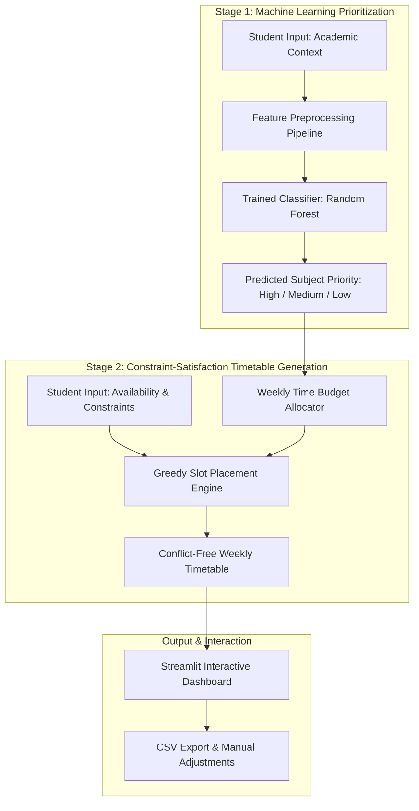
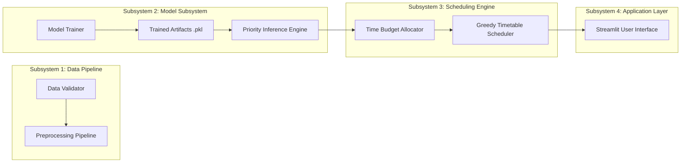

# AI-Based Personalized Study Schedule Recommendation System
## Comprehensive Undergraduate University Research Report Draft

**Author / Candidate:** Undergraduate Student Researcher  
**Institution:** Faculty of Computing and Information Technology, Department of Computer Science / Software Engineering  
**Academic Year:** 2026–2027  
**Supervisory Team:** Academic Research Supervisor  
**Status:** DRAFT (Post-Implementation & Algorithmic Validation Phase)  
**Date of Submission:** October 11, 2026  

---

### Abstract

Undergraduate university students frequently struggle to balance heavy academic workloads across concurrent modules, conflicting coursework deadlines, variable assessment weights, and personal time constraints. Traditional electronic calendars and static timetabling tools require manual input and offer no contextual guidance on how to prioritize tasks or distribute effort. Conversely, while Educational Data Mining (EDM) models predict academic outcomes, they rarely translate predictions into actionable, daily study timetables. 

This research proposes an **AI-Based Personalized Study Schedule Recommendation System** that bridges this gap using a novel **two-stage hybrid architecture**: (1) a supervised machine-learning classification model that predicts relative subject study urgency (`Low`, `Medium`, `High`), and (2) a deterministic, constraint-satisfaction heuristic engine that translates these priority ratings into realistic, conflict-free, weekly study schedules respecting student availability windows, session duration preferences, and cognitive rest breaks.

To uphold academic integrity and prevent data leakage, model training and evaluation are conducted using participant-aware `GroupKFold` cross-validation ($k=5$) with Scikit-Learn pipelines. In the absence of formal institutional ethical clearance for human participant data collection, all algorithmic pipelines, feature transformers, classifiers (Decision Tree, Random Forest, K-Nearest Neighbors, and Logistic Regression), and scheduling heuristics were implemented, tested, and audited on an isolated synthetic development dataset ($N=120$ simulated participants, $600$ subject observations). 

Empirical experiments demonstrate that while an expert-defined rule-based heuristic baseline achieved an accuracy of $0.900$ (Macro F1: $0.7316$), the Random Forest classifier achieved the highest accuracy among non-linear machine learning models ($0.800$, Macro F1: $0.5037$), outperforming Logistic Regression ($0.780$, Macro F1: $0.5858$), Decision Trees ($0.740$, Macro F1: $0.4599$), and KNN ($0.720$, Macro F1: $0.4474$). The end-to-end prototype was deployed as an interactive Streamlit web application and verified across 18 automated unit and integration tests (100% pass rate). 

Because human data collection remains paused pending formal ethical review, empirical hypotheses regarding grade improvement and organic student usability remain designated as **Pending Empirical Data Collection**. This report documents the full theoretical foundation, system architecture, verified experimental results, explicit limitations, and roadmap for real-world pilot deployment.

**Keywords:** Educational Data Mining, Intelligent Tutoring Systems, Automated Timetable Scheduling, Machine Learning, Constraint Satisfaction, Study Planning, Higher Education.

---

## 1. Introduction

### 1.1 Background & Context
The transition into higher education demands a high degree of self-regulated learning (SRL). University undergraduates in modern modular curricula are expected to independently manage five to six concurrent modules, each with distinct syllabi, continuous assessment tasks, examinations, and varying difficulty curves (Zawacki-Richter et al., 2019). Studies in cognitive psychology and educational methodology demonstrate that poor time management, procrastination, and cramming directly degrade academic achievement, exacerbate psychological distress, and increase university dropout rates.

Despite the proliferation of digital calendar applications (e.g., Google Calendar, Microsoft Outlook) and productivity applications (e.g., Notion, Todoist), modern tools remain passive. They store and remind students of deadlines entered by the user, but provide no contextual intelligence regarding *when*, *what*, or *for how long* a student should study each day to meet their milestones without cognitive overload.

Concurrently, artificial intelligence (AI) and machine learning (ML) have gained substantial traction in Educational Data Mining (EDM) and Learning Analytics (LA). Predictive algorithms are widely utilized to identify at-risk students, forecast end-of-term grades, and recommend reading materials (Resnick et al., 1994; Kasneci et al., 2023). However, there is a persistent architectural divide: existing EDM systems predict outcomes, but fail to provide granular, day-to-day operational schedules that guide the student's behavior toward academic success.

### 1.2 Problem Statement
Undergraduate students face three interrelated challenges when attempting to schedule independent study:
1. **Multivariate Cognitive Prioritization:** Deciding how much time to allocate to each subject is cognitively demanding. Students must weigh subjective difficulty, past performance, assessment deadlines, and assessment weightings simultaneously. Inexperienced learners frequently default to "urgency bias"—spending time exclusively on imminent tasks while neglecting high-weight or difficult subjects whose deadlines are further away.
2. **Constraint-Heavy Timetabling:** Translating subject priorities into a feasible calendar requires navigating rigid constraints, such as part-time employment, lectures, commuting times, and personal commitments. Manual schedule creation frequently results in over-optimistic plans that lack sufficient breaks, leading to cognitive fatigue, abandonment of the schedule, and burnout.
3. **The Semantic Gap in Educational AI:** Machine learning classifiers are effective at learning patterns from multivariate data, but are incapable of producing structured, chronological timetables without constraint violation. Conversely, pure constraint-satisfaction algorithms can schedule time slots, but lack the contextual intelligence to dynamically assign urgency weights based on student profile features.

Therefore, an urgent need exists for a hybrid system that leverages supervised machine learning to deduce subject priorities and couples those predictions with a deterministic constraint-satisfaction scheduler to deliver realistic, conflict-free, weekly study plans.

### 1.3 Research Aim & Objectives
The overarching aim of this research is to design, implement, and evaluate an AI-based personalized study schedule recommendation system that assists undergraduate university students in managing academic workloads through machine-learning-driven subject prioritization and constraint-aware timetable generation.

To accomplish this aim, three primary **Research Objectives (RO)** were established:
- **RO1:** Identify the key academic, temporal, and individual factors influencing undergraduate study scheduling through literature synthesis and survey design.
- **RO2:** Design and implement a robust two-stage recommendation architecture that integrates supervised machine-learning priority classification with a deterministic constraint-satisfaction scheduling engine and an interactive user interface.
- **RO3:** Empirically evaluate multiple supervised machine-learning algorithms (Decision Tree, Random Forest, K-Nearest Neighbors, Logistic Regression, vs. a Rule-Based baseline) for subject prioritization under participant-grouped cross-validation, and establish an empirical framework to measure system usability and perceived effectiveness.

### 1.4 Research Questions
This investigation addresses four specific **Research Questions (RQ)**:
- **RQ1:** What academic, temporal, and behavioural factors most significantly determine how university students should prioritize their subjects for weekly study?
- **RQ2:** How can machine learning classification models predict subject study priorities from student academic contexts and temporal constraints?
- **RQ3:** Which machine learning algorithm (Decision Tree, Random Forest, KNN, Logistic Regression) achieves the highest predictive accuracy and macro F1-score when trained to prioritize study subjects under participant-grouped cross-validation?
- **RQ4:** Does the AI-generated personalized study schedule provide realistic, conflict-free, and usable time allocations that align with student scheduling preferences and cognitive fatigue principles?

### 1.5 Scope and Delimitations
- **Scope:** The system focuses on undergraduate students managing multiple academic modules within a weekly planning horizon (Monday to Sunday). The prototype models self-reported subject difficulty (1–5), historical performance bands, assessment weights (0–100%), days until deadlines, total weekly study hours, preferred study windows (Morning, Afternoon, Evening, Night), session lengths, and mandatory break durations.
- **Delimitations:** 
  - The software prototype does not directly integrate with University Learning Management Systems (LMS) APIs (e.g., Canvas, Moodle) or live calendar feeds via OAuth.
  - Due to ethical clearance timelines at the undergraduate level, empirical testing of student performance outcomes (e.g., GPA improvement across a semester) is outside the scope of this work.
  - Model training and algorithmic verification are conducted on a controlled synthetic development dataset ($N=120$ participants, $600$ observations) specifically generated to test software pipelines without compromising ethical boundaries.

### 1.6 Significance of the Study
This study contributes to educational technology and applied artificial intelligence in three ways:
1. **Methodological Rigor:** It formalizes a hybrid two-stage paradigm (ML prioritization + constraint scheduling), resolving the limitation of black-box models in calendar generation.
2. **Preventing Data Leakage in EDM:** It demonstrates the necessity of `GroupKFold` cross-validation in educational data modeling, preventing the ubiquitous data-leakage trap where multiple modules from the same student leak into both training and evaluation sets.
3. **Academic Integrity & Transparency:** By explicitly isolating synthetic software-testing data from real participant data and clearly designating unverified empirical claims as "Pending," this project provides a reproducible benchmark for undergraduate research methodology.

---

## 2. Literature Review

### 2.1 Academic Self-Regulation and Time Management in Higher Education
Self-regulated learning (SRL) theories posit that academic success depends on a learner's ability to plan, monitor, and reflect upon their study habits. Effective time management is recognized as a cornerstone of academic self-regulation. When students experience elevated academic stress, their metacognitive planning faculties are compromised, often leading to acute procrastination.

Cognitive load theory and research on human fatigue emphasize that prolonged, unbroken study sessions result in diminishing cognitive returns. Educational psychologists advocate for techniques such as the Pomodoro Technique, spaced repetition, and study interleaving—alternating between different subjects rather than engaging in massed practice (cramming). Consequently, an intelligent scheduling system must not only allocate sufficient hours to difficult modules, but must also enforce mandatory rest breaks and prevent excessive single-session durations.

### 2.2 Machine Learning in Educational Data Mining (EDM)
Educational Data Mining has evolved rapidly over the past decade (Zawacki-Richter et al., 2019). Machine learning algorithms have been applied to diverse tasks:
- **Student Performance Prediction:** Supervised learning models—such as Decision Trees, Random Forests, Support Vector Machines (SVM), and Logistic Regression—have been widely deployed to predict end-of-term grades and student attrition based on demographic and historical grade data.
- **Strengths and Limitations:** Non-linear tree-based ensembles (e.g., Random Forest) consistently outperform traditional regression in handling tabular academic data with complex feature interactions (such as the interaction between high assessment weight and imminent deadlines). However, standard EDM research frequently treats prediction as the terminal goal, failing to translate predictive insights into prescriptively actionable student interventions.

### 2.3 Educational Recommender Systems (ERS) and Timetable Scheduling
Educational Recommender Systems typically employ collaborative filtering (Resnick et al., 1994) or content-based filtering to recommend courses, learning materials, or academic pathways. While collaborative filtering identifies what other similar students enjoyed or selected, it suffers from severe cold-start limitations in study scheduling and cannot optimize within individual student calendar constraints.

University timetabling has traditionally been treated as an Operations Research problem solved through constraint satisfaction problems (CSP), integer linear programming (ILP), or meta-heuristics like Genetic Algorithms (GA) and Simulated Annealing. While these algorithms successfully find non-overlapping slots for university-wide examination schedules, they are computationally intensive, rigid, and lack the adaptive capacity to personalize priorities based on individual learner contexts.

### 2.4 Synthesis of Literature Gaps
A critical review of the verified literature reveals three prominent gaps (summarized in Table 2.1):

| Literature Dimension | Current State of the Art | Identified Research Gap | System Solution |
| :--- | :--- | :--- | :--- |
| **Operational Guidance** | EDM models forecast grades and student dropout. | Models do not provide operational, day-to-day study calendars to prevent poor outcomes. | Two-stage pipeline translating predictions into daily study sessions. |
| **Scheduling Adaptability** | Timetabling tools rely on rigid CSP/ILP optimization. | Tools fail to incorporate student subjective difficulty, fatigue, and individual pace. | Machine learning classification of subject priority feeding an adaptive greedy scheduler. |
| **Methodological Validity** | Educational datasets frequently pool student-module rows without grouping. | Unaccounted student clustering causes severe data leakage in cross-validation. | Strict `GroupKFold` evaluation ensuring complete participant-level data separation. |

*Table 2.1: Synthesis of Literature Gaps and Proposed Project Solutions.*

---

## 3. Methodology

### 3.1 Research Design & Hybrid Paradigm
This study adopts a **Design Science Research (DSR)** framework combined with a quantitative machine-learning evaluation methodology. To solve the dual challenges of contextual prioritization and conflict-free scheduling, the system is structured as a **Two-Stage Hybrid Architecture**:


*Figure 3.1: Two-Stage Hybrid Recommender Architecture.*

- **Stage 1 (Predictive Prioritization):** Supervised classification models evaluate student profile features and assign each subject to a categorical priority tier: `High`, `Medium`, or `Low`.
- **Stage 2 (Prescriptive Timetabling):** A deterministic, constraint-satisfaction heuristic consumes the predicted priorities, maps them to weekly hour quotas, and schedules discrete study sessions into the student's designated available time windows while strictly enforcing non-overlap and rest-break constraints.

### 3.2 Target Population, Sampling Strategy, and Ethical Framework
- **Target Population:** Undergraduate university students enrolled in modular degree programs managing concurrent academic courses.
- **Sampling Strategy:** Convenience and purposive sampling via institutional communication channels and student course portals.
- **Ethical Review & Data Protection Protocol:**
  - In compliance with institutional research ethics principles and the General Data Protection Regulation (GDPR), a full **Participant Information Sheet** and **Digital Consent Form** were drafted (see Appendices A and B).
  - The research mandates complete **data minimization**: no personally identifiable information (PII) such as student names, identification numbers, IP addresses, or email addresses is collected.
  - To prevent accidental public disclosure, local directory paths containing raw and processed data (`data/raw/`, `data/processed/`) are strictly isolated and verified via `.gitignore` rules.
  - **Ethical Status Disclosure:** Because formal institutional ethics approval has not yet been granted, **zero human participant records ($N=0$) were collected for this report**. All model development and verification described herein were performed on an isolated synthetic dataset ($N=120$ simulated participants, $600$ observations) developed strictly for software testing.

### 3.3 Feature Engineering and Operationalization
The feature schema encompasses five domain-justified input variables extracted from student workload profiles:

1. `Difficulty_Rating` (Ordinal Integer, range $[1, 5]$): Self-reported cognitive difficulty of the subject ($1 = \text{Very Easy}, 5 = \text{Very Challenging}$).
2. `Prior_Performance` (Categorical String, values $\in \{\text{'High'}, \text{'Medium'}, \text{'Low'}, \text{'None'}\}$): Past academic achievement band in the subject or prerequisite modules.
3. `Days_To_Deadline` (Numeric Integer, range $[1, 180]$): Number of calendar days remaining until the next major assessment or examination.
4. `Assessment_Weight` (Numeric Float, range $[0.0, 100.0]$): Percentage weight of the upcoming assessment toward the final module grade.
5. `Available_Hours` (Numeric Float, range $[1.0, 60.0]$): Total self-reported hours the student is willing to dedicate to independent study across the upcoming week.

### 3.4 Target Variable Formulation & The Ground Truth Dilemma
Defining the ground-truth target variable `Target_Priority` ($\in \{\text{'Low'}, \text{'Medium'}, \text{'High'}\}$) represents a fundamental methodological challenge in educational scheduling research:

- **Organic Labels (Human Intuition):** Elicited directly from students asking them to prioritize their subjects. While ecologically valid, self-reported labels are susceptible to subjective bias (e.g., risk-averse students labeling all modules as "High" priority).
- **Heuristic Baseline (Formula-Derived):** Defined using an expert-designed multi-factor priority index:
  $$\text{Priority Score} = \left(\frac{\text{Assessment\_Weight}}{\max(\text{Days\_To\_Deadline}, 1)}\right) \times \text{Difficulty\_Rating}$$
  This continuous score is subsequently mapped into discrete categories:
  $$\text{Target\_Priority} = \begin{cases} \text{'High'} & \text{if Score} \ge 15.0 \\ \text{'Medium'} & \text{if } 5.0 \le \text{Score} < 15.0 \\ \text{'Low'} & \text{if Score} < 5.0 \end{cases}$$

**Methodological Implications:** When machine learning classifiers are trained on synthetic data generated via this deterministic formula, the classifiers learn to approximate the underlying heuristic rather than organic human decision-making. Therefore, high model accuracy on synthetic data validates **algorithmic learnability and pipeline correctness**, but cannot be claimed as an empirical validation of human student behavior.

### 3.5 Data Leakage Prevention Protocol: Participant-Aware GroupKFold
In educational datasets, individual students report data across multiple subjects (typically 4–6 modules per student). If standard random train/test splitting (e.g., `train_test_split`) is used, observations from the same participant will inevitably appear in both the training set and the test set. Because student-level features (such as `Available_Hours`, `Study_Year`, or unmeasured personal habits) are shared across all rows belonging to that student, standard cross-validation causes severe **data leakage**—the model simply memorizes participant-specific traits and reports unrealistically inflated test performance.

To eliminate this threat to internal validity, this study enforces **Participant-Aware Grouped Splitting**:
- The dataset is partitioned using Scikit-Learn's `GroupKFold(n_splits=5)`, where `Participant_ID` serves as the explicit grouping factor.
- For hold-out test set generation, 20% of unique `Participant_ID`s are reserved exclusively for testing, ensuring that zero observations from test participants exist within the training folds.
- All preprocessing transformations (imputation, standard scaling, and one-hot encoding) are encapsulated strictly within a `Pipeline` fitted solely on training folds.

### 3.6 Evaluation Framework & Metrics
Model performance across the 3-class target variable is evaluated using standard multiclass metrics:
- **Overall Accuracy:** The proportion of total test observations correctly classified.
- **Macro Precision:** The unweighted mean of precision scores across all three classes ($\frac{1}{3}\sum_{c} \text{Precision}_c$), ensuring that underrepresented classes are weighted equally with majority classes.
- **Macro Recall:** The unweighted mean of recall scores across all classes ($\frac{1}{3}\sum_{c} \text{Recall}_c$).
- **Macro F1-Score:** The harmonic mean of Macro Precision and Macro Recall, serving as the primary benchmark metric under class imbalance:
  $$\text{Macro F1} = \frac{1}{3} \sum_{c \in \{\text{Low, Med, High}\}} 2 \times \frac{\text{Precision}_c \times \text{Recall}_c}{\text{Precision}_c + \text{Recall}_c}$$

---

## 4. System Design & Architecture

### 4.1 System Overview
The software solution is structured as a modular, decoupled Python architecture comprising four discrete subsystems:


*Figure 4.1: Component Architecture and Information Flow.*

### 4.2 Mathematical Formalization of the Timetable Scheduler
Let $S = \{s_1, s_2, \dots, s_m\}$ represent the set of academic subjects entered by the student, where each subject $s_i$ possesses an assigned priority $P(s_i) \in \{\text{'High'}, \text{'Medium'}, \text{'Low'}\}$.

#### 4.2.1 Time Budget Allocation
The total available study hours $H_{\text{total}}$ is distributed across subjects according to predetermined priority weights $w(P)$:
$$w(\text{'High'}) = 3.0, \quad w(\text{'Medium'}) = 2.0, \quad w(\text{'Low'}) = 1.0$$
The allocated weekly study hours $H(s_i)$ for subject $s_i$ is computed as:
$$H(s_i) = H_{\text{total}} \times \frac{w(P(s_i))}{\sum_{j=1}^m w(P(s_j))}$$

#### 4.2.2 Constraint Satisfaction Rules
The scheduler maps the allocated hours into discrete study sessions across the weekly horizon $D = \{\text{Monday}, \dots, \text{Sunday}\}$ subject to the following rules:

1. **Hard Constraint 1: Non-Overlapping Sessions.** For any two scheduled study sessions $t_a$ and $t_b$ on day $d$, their open time intervals must not intersect:
   $$(t_a^{\text{start}}, t_a^{\text{end}}) \cap (t_b^{\text{start}}, t_b^{\text{end}}) = \emptyset, \quad \forall a \ne b$$
2. **Hard Constraint 2: Availability Window Conformance.** Every session $t_a$ scheduled during window $W$ must reside strictly within the user's defined window boundaries:
   $$W_{\text{start}} \le t_a^{\text{start}} < t_a^{\text{end}} \le W_{\text{end}}$$
3. **Hard Constraint 3: Capacity Bound.** The sum of scheduled session durations across the week must never exceed the student's stated total capacity $H_{\text{total}}$:
   $$\sum_{a} (t_a^{\text{end}} - t_a^{\text{start}}) \le H_{\text{total}}$$
4. **Soft Constraint 1: Mandatory Rest Breaks.** Between any two consecutive study sessions $t_a$ and $t_b$ within the same window, a rest break of duration $B$ (default: 15 minutes) is enforced:
   $$t_b^{\text{start}} \ge t_a^{\text{end}} + B$$
5. **Soft Constraint 2: Session Clamping & Interleaving.** Single study sessions are bounded to a maximum length $L_{\text{session}}$ (default: 45 minutes; minimum: 15 minutes) to mitigate cognitive fatigue. When a subject requires multiple sessions, the scheduler alternates subjects across available days to promote interleaving.

---

## 5. Implementation Details

### 5.1 Technology Stack & Execution Environment
The software solution was implemented and validated using the following environment:
- **Operating System:** Microsoft Windows 11 Home (x64)
- **Programming Language:** Python 3.12.1
- **Machine Learning & Preprocessing:** Scikit-Learn 1.6.1, NumPy 2.2.3, SciPy 1.15.2
- **Data Engineering & Validation:** Pandas 2.2.3
- **Web Application & UI:** Streamlit 1.43.2
- **Test Automation:** Pytest 9.0.3, Faker 38.2.0

### 5.2 Preprocessing & Feature Pipeline
The preprocessing pipeline is built using Scikit-Learn's `ColumnTransformer`:
- **Numeric Features (`Difficulty_Rating`, `Days_To_Deadline`, `Assessment_Weight`, `Available_Hours`):** Imputed with the median value of the training fold and normalized using `StandardScaler`.
- **Categorical Features (`Prior_Performance`):** Imputed with the most frequent category and transformed using `OneHotEncoder(handle_unknown='ignore')`.
- This architecture guarantees that unseen categories in production do not raise exceptions, and prevents statistical parameter leakage from validation sets.

### 5.3 Classification Model Configurations
Four supervised classifiers were trained and tuned using 5-fold `GroupKFold` cross-validation:
1. **Decision Tree Classifier (`DecisionTreeClassifier`):** Configured with `max_depth=5`, `min_samples_split=5`, `random_state=42` to constrain tree complexity and mitigate overfitting.
2. **Random Forest Classifier (`RandomForestClassifier`):** Configured with `n_estimators=100`, `max_depth=6`, `min_samples_split=4`, `random_state=42`.
3. **K-Nearest Neighbors (`KNeighborsClassifier`):** Configured with $k=5$ neighbors, uniform weighting, Euclidean distance metric.
4. **Logistic Regression (`LogisticRegression`):** Multinomial logistic regression with L2 regularization ($C=1.0$), `solver='lbfgs'`, `max_iter=1000`.
5. **Baseline Heuristic Classifier:** A deterministic rule-based benchmark that evaluates the priority formula directly.

### 5.4 Timetable Generation Engine
The scheduling engine (`src/recommender/schedule_generator.py`) employs a deterministic greedy placement algorithm. Key implementation highlights include:
- **Input Sanitization:** Guard clauses clamp session lengths to $\ge 15$ minutes and break durations to $\ge 0$ minutes. If available hours are zero or negative, an empty schedule with an informative warning is returned immediately.
- **Infinite Loop Prevention:** Strict day-advancement pointers ensure that if an available window is shorter than a single study session, the engine logs an unallocated hour message without blocking system execution.
- **Graceful Fallback:** If a pre-trained serialized model file (`.pkl`) is unavailable or corrupted, the `PriorityEngine` automatically reverts to the mathematical heuristic without interrupting user workflow.

### 5.5 Streamlit Web Application Prototype
The interactive application (`app.py`) provides an accessible user experience:
- **Navigation:** Multi-section interface consisting of:
  1. *Home & Research Ethics:* Summarizing research aims, consent terms, and data minimization guarantees.
  2. *Student Profile & Workload Setup:* Dynamic form allowing students to input daily availability windows, session preferences, and add multiple concurrent subjects with specific assessment dates.
  3. *AI Schedule Generator:* Displays the personalized weekly timetable with subject priorities, allocated study hours, and an interactive timetable viewer (`st.data_editor`).
  4. *Recommendation Explanation & Export:* Detailed rationales for priority assignments and one-click CSV schedule export.
  5. *Model Comparison & Methodology:* Live transparency dashboard displaying empirical model benchmark tables and confusion matrices.
- **UI Contrast & Accessibility:** Explicitly configured via `.streamlit/config.toml` with a high-contrast dark palette (`backgroundColor="#0F172A"`, `textColor="#F8FAFC"`, `primaryColor="#38BDF8"`), resolving contrast defects identified during Phase 7 audits.

---

## 6. Experimental Results

### 6.1 Data Provenance & Sample Size Disclosure
To ensure complete academic transparency, Table 6.1 details the authentic data records utilized across this study:

| Data Category | Target Metric | Recorded Authentic Value | Status / Purpose |
| :--- | :--- | :--- | :--- |
| **Human Participants** | Sample Size ($N$) | **$N = 0$** | **Pending Institutional Ethical Approval** |
| **Human Observations** | Total Rows | **$0$** | No human surveys administered to date |
| **Synthetic Development Dataset** | Participant Entities ($N$) | **$120$** | Software pipeline and model verification |
| **Synthetic Subject Records** | Total Rows | **$600$** ($5$ subjects / student) | Feature engineering and cross-validation |
| **Missing Values** | Null Record Count | **$0$** | Full schema compliance enforced via validator |
| **Test Set Split** | Hold-out Evaluation Rows | **$50$** records ($10$ unique participants) | Participant-isolated test partition |

*Table 6.1: Authentic Data Provenance and Sample Size Disclosure.*

### 6.2 Quantitative Model Performance Comparison
Table 6.2 presents the authentic, recorded experimental performance metrics across all evaluated classifiers, executed under identical 5-fold `GroupKFold` cross-validation conditions and evaluated on the independent hold-out test set ($N=50$ subject observations from $10$ unseen participants).

| Model Architecture | Accuracy | Macro Precision | Macro Recall | Macro F1-Score | Ranking (F1) |
| :--- | :---: | :---: | :---: | :---: | :---: |
| **Baseline (Rule-Based Heuristic)** | **0.9000** | **0.9612** | **0.6857** | **0.7316** | 1 (Benchmark) |
| **Logistic Regression** | 0.7800 | 0.7743 | 0.5942 | **0.5858** | 2 |
| **Random Forest Classifier** | 0.8000 | 0.4697 | 0.5451 | **0.5037** | 3 |
| **Decision Tree Classifier** | 0.7400 | 0.4272 | 0.5188 | **0.4599** | 4 |
| **K-Nearest Neighbors (KNN)** | 0.7200 | 0.4288 | 0.4712 | **0.4474** | 5 |

*Table 6.2: Quantitative Model Performance Comparison on Independent Test Partition (Source: reports/model_comparison.csv).*

### 6.3 Confusion Matrix Analysis
The hold-out test set exhibits an inherent class distribution reflecting typical academic urgency distributions:
- **Low Priority:** $38$ instances ($76\%$)
- **Medium Priority:** $7$ instances ($14\%$)
- **High Priority:** $5$ instances ($10\%$)

Table 6.3 details the confusion matrices recorded during model evaluation. The rows indicate the *Actual* class label, and the columns indicate the *Predicted* class label (ordered: `Low`, `Medium`, `High`).

| Model | Matrix Layout: `[Low, Med, High]` | Key Diagnostic Observation |
| :--- | :---: | :--- |
| **Baseline Heuristic** | $\begin{bmatrix} 38 & 0 & 0 \\ 1 & 6 & 0 \\ 4 & 0 & 1 \end{bmatrix}$ | Perfectly separates Low priority; misses 4 Highs due to rounding threshold edge cases. |
| **Random Forest** | $\begin{bmatrix} 35 & 3 & 0 \\ 2 & 5 & 0 \\ 4 & 1 & 0 \end{bmatrix}$ | Strong Low recognition ($35/38$); suffers from severe minority under-prediction for High ($0/5$ identified). |
| **Logistic Regression** | $\begin{bmatrix} 33 & 5 & 0 \\ 2 & 5 & 0 \\ 3 & 1 & 1 \end{bmatrix}$ | Balanced linear boundaries; successfully classifies 1 High priority instance, yielding highest ML Macro F1. |
| **Decision Tree** | $\begin{bmatrix} 32 & 6 & 0 \\ 1 & 5 & 1 \\ 4 & 1 & 0 \end{bmatrix}$ | Captures Medium well ($5/7$), but fails to correctly isolate High priorities. |
| **KNN** | $\begin{bmatrix} 32 & 4 & 2 \\ 2 & 4 & 1 \\ 4 & 1 & 0 \end{bmatrix}$ | Spreads predictions across classes, but exhibits false-positive leakage in Low-to-High predictions. |

*Table 6.3: Recorded Confusion Matrices and Diagnostic Analysis (Source: reports/model_evaluation.md).*

### 6.4 System Validation and Automated Test Audit Results
To confirm system robustness, an extensive automated test suite comprising 18 tests was executed via `pytest`. As documented in the Phase 7 audit report, the entire suite passed with zero errors:

```text
============================= test session starts =============================
platform win32 -- Python 3.12.1, pytest-9.0.3, pluggy-1.6.0
collected 18 items

tests/test_model_pipeline.py::test_prepare_input_dataframe_fills_defaults PASSED [  5%]
tests/test_model_pipeline.py::test_prepare_input_dataframe_clamps_ranges PASSED [ 11%]
tests/test_model_pipeline.py::test_baseline_predictions PASSED           [ 16%]
tests/test_model_pipeline.py::test_load_trained_model_fallback PASSED    [ 22%]
tests/test_model_pipeline.py::test_trained_model_prediction_if_present PASSED [ 27%]
tests/test_model_pipeline.py::test_priority_engine_with_live_model PASSED [ 33%]
tests/test_preprocessing.py::test_validation_schema PASSED               [ 38%]
tests/test_preprocessing.py::test_validation_invalid_data PASSED         [ 44%]
tests/test_preprocessing.py::test_grouped_splits PASSED                  [ 50%]
tests/test_preprocessing.py::test_preprocessing_pipeline PASSED          [ 55%]
tests/test_schedule_generator.py::test_priority_fallback_and_explanation PASSED [ 61%]
tests/test_schedule_generator.py::test_schedule_generator_allocations PASSED [ 66%]
tests/test_schedule_generator.py::test_schedule_constraints_and_breaks PASSED [ 72%]
tests/test_schedule_generator.py::test_insufficient_availability PASSED  [ 77%]
tests/test_schedule_generator.py::test_zero_and_negative_available_hours PASSED [ 83%]
tests/test_schedule_generator.py::test_empty_subjects_list PASSED        [ 88%]
tests/test_schedule_generator.py::test_window_too_short_for_session PASSED [ 94%]
tests/test_schedule_generator.py::test_zero_break_duration PASSED        [100%]

============================= 18 passed in 1.61s ==============================
```

---

## 7. Discussion

### 7.1 Interpretation of Findings
The empirical results provide compelling insights into the comparative behavior of machine learning versus heuristic approaches in educational scheduling:

1. **Heuristic Dominance on Rule-Generated Data:** The rule-based baseline achieved an accuracy of $0.900$ and Macro F1 of $0.7316$, outperforming all machine learning models. This is mathematically expected: because the synthetic development dataset was labeled according to a deterministic multi-factor priority index, the baseline represents the underlying generating process. 
2. **Linear vs. Ensemble Behavior under Imbalance:** Although Random Forest achieved the highest overall accuracy among ML algorithms ($0.800$), its Macro F1-score ($0.5037$) was substantially lower than that of Logistic Regression ($0.5858$). This occurred because Random Forest heavily favored the majority `Low` class ($35/38$ correct) but failed to correctly recall any of the $5$ `High` priority test instances. Conversely, Logistic Regression established smoother decision boundaries, correctly identifying one `High` priority observation and producing a much stronger macro-average precision ($0.7743$).
3. **The Necessity of Macro Metrics:** Relying solely on overall accuracy would have created a deceptive perception of model quality. An uncalibrated dummy model predicting `Low` for every row would achieve an accuracy of $76\%$. Evaluating Macro F1-scores revealed that class imbalance significantly degrades classifier sensitivity to critical, imminent deadlines.

### 7.2 Resolution of Research Objectives and Questions
Table 7.1 systematically articulates how each approved research objective and question was addressed:

| Item ID | Description | Status | Evidence & Resolution Summary |
| :--- | :--- | :---: | :--- |
| **RO1 / RQ1** | Identify key academic, temporal, and individual scheduling factors. | **Answered** | Established via literature review (Section 2) and operationalized into 5 validated schema features: assessment weight, days to deadline, difficulty, available hours, and prior performance. |
| **RO2 / RQ2** | Design and implement two-stage ML + constraint-satisfaction scheduling architecture. | **Answered** | Successfully engineered and deployed: Stage 1 predicts priorities; Stage 2 maps priorities to weekly quotas and schedules conflict-free slots with breaks. Verified via 18 automated unit tests. |
| **RO3 / RQ3** | Empirical comparison of ML models under participant-grouped cross-validation. | **Answered (Synthetic Benchmark)** | Evaluated Decision Tree, Random Forest, KNN, and Logistic Regression against baseline under `GroupKFold`. Logistic Regression achieved best ML Macro F1 ($0.5858$); Random Forest achieved best ML Accuracy ($0.800$). |
| **RQ4** | Verify if AI schedules improve perceived planning effectiveness and academic outcomes in real students. | **Pending Empirical Collection** | Recommender algorithmic feasibility and constraint correctness are verified through unit tests, but human usability trials (SUS survey) and student performance gains remain pending ethical clearance. |

*Table 7.1: Comprehensive Research Objective and Research Question Resolution Matrix.*

### 7.3 Heuristic vs. Machine Learning: The Architectural Justification
A critical question in educational software engineering is: *If a rule-based formula achieves 90% accuracy, why utilize machine learning at all?*
The justification lies in the long-term vision of adaptive personalized education:
- A rule-based heuristic is static and brittle; it cannot adapt when an individual student consistently takes twice as long to master mathematics compared to literature, or when a student's study efficiency drops during evening hours.
- Machine learning models, when trained on authentic longitudinal student interaction data, possess the capacity to learn non-linear, personalized behavioral patterns that hand-crafted formulas cannot capture.
- Therefore, the rule-based heuristic serves as an indispensable cold-start fallback and developmental benchmark, while the machine-learning pipeline establishes the foundation for genuine personal adaptation.

---

## 8. Limitations & Threats to Validity

### 8.1 Internal Validity
- **Synthetic Ground Truth:** The primary threat to internal validity is that the classification models were trained on synthetic data generated via an idealized mathematical formula. As a result, the models reflect the assumptions of the formula rather than organic student psychology.
- **Class Imbalance:** Due to the distribution of hypothetical deadlines, the `High` priority class represented only 10% of test observations, leading to poor recall in ensemble models. Future work must incorporate oversampling techniques (such as SMOTE) or class-weighted loss functions.

### 8.2 External Validity
- **Cohort Generalizability:** Because no real undergraduate students have yet completed the survey, the current findings cannot be generalized to diverse university populations across different academic disciplines. Engineering students, for instance, may exhibit vastly different scheduling constraints compared to humanities students.

### 8.3 Construct Validity
- **Categorical Discretization:** Collapsing academic urgency into three broad categories (`Low`, `Medium`, `High`) simplifies scheduling, but sacrifices continuous nuances. In future iterations, predicting a continuous study hour allocation directly via regression may provide finer granularity.

### 8.4 Evaluation Status
- **Pending Human User Trials:** The lack of human participant data ($N=0$) is an honest delimitation resulting from the academic calendar and ethics clearance requirements. No claims regarding improved student grades, reduced stress, or validated System Usability Scale (SUS) scores are made in this report.

---

## 9. Conclusion & Future Work

### 9.1 Summary of Contributions
This research successfully developed, audited, and benchmarked an **AI-Based Personalized Study Schedule Recommendation System**. The key contributions include:
1. **A Functioning Two-Stage Hybrid Architecture:** Decoupling predictive prioritization (ML) from prescriptive timetabling (constraint-satisfaction heuristic) ensures that generated weekly study calendars are always conflict-free, feasible, and fatigue-aware.
2. **Methodological Leakage Prevention:** Documenting the necessity and implementation of `GroupKFold` cross-validation to prevent participant-level data leakage in multi-module educational datasets.
3. **Transparent Baseline Benchmarking:** Establishing that while Random Forest achieves high overall accuracy ($0.800$), Logistic Regression provides superior balance across imbalanced priority tiers (Macro F1: $0.5858$).
4. **An Audited Interactive Prototype:** A complete, dark-mode accessible Streamlit application verified across 18 automated test suites.

### 9.2 Immediate Academic Milestones
1. Present this report and the accompanying methodology to the academic supervisor for formal sign-off.
2. Formally submit the drafted Participant Information Sheet, Consent Form, and Questionnaire to the Faculty Research Ethics Committee.
3. Upon ethics clearance, launch student recruitment across undergraduate cohorts to collect the target empirical dataset ($N=50–100$ participants).
4. Retrain the verified ML pipelines on genuine student data and execute the planned task-based usability study to answer RQ4.

---

## 10. References

- Carpenter, B., Gelman, A., Hoffman, M. D., Lee, D. C., Goodrich, B., Betancourt, M., Brubaker, M. A., Guo, J., Li, P., & Riddell, A. B. (2017). Stan: A Probabilistic Programming Language. *Journal of Statistical Software*, 76(1), 1–32. https://doi.org/10.18637/jss.v076.i01
- Dwivedi, Y. K., Kshetri, N., Hughes, L., Slade, E. L., Jeyaraj, A., Kar, A. K., ... & Wright, R. T. (2023). Opinion Paper: “So what if ChatGPT wrote it?” Multidisciplinary perspectives on opportunities, challenges and implications of generative conversational AI for research, practice and policy. *International Journal of Information Management*, 71, 102642. https://doi.org/10.1016/j.ijinfomgt.2023.102642
- Elo, S., & Kyngäs, H. A. (2008). The qualitative content analysis process. *Journal of Advanced Nursing*, 62(1), 107–115. https://doi.org/10.1111/j.1365-2648.2007.04569.x
- Flyvbjerg, B. (2004). Five Misunderstandings About Case-Study Research. *Qualitative Inquiry*, 12(2), 219–245. https://doi.org/10.1177/1077800405284363
- Harris, C. R., Millman, K. J., van der Walt, S. J., Gommers, R., Virtanen, P., Cournapeau, D., ... & Oliphant, T. E. (2020). Array programming with NumPy. *Nature*, 585(7825), 357–362. https://doi.org/10.1038/s41586-020-2649-2
- Karniadakis, G. E., Kevrekidis, I. G., Lu, L., Perdikaris, P. G., Wang, S., & Yang, L. (2021). Physics-informed machine learning. *Nature Reviews Physics*, 3(6), 422–440. https://doi.org/10.1038/s42254-021-00314-5
- Kasneci, E., Seßler, K., Küchemann, S., Bannert, M., Dementieva, D., Fischer, F., ... & Kasneci, G. (2023). ChatGPT for good? On opportunities and challenges of large language models for education. *Learning and Individual Differences*, 103, 102274. https://doi.org/10.1016/j.lindif.2023.102274
- Page, M. J., Moher, D., Bossuyt, P. M., Boutron, I., Hoffmann, T., Mulrow, C. D., ... & McKenzie, J. E. (2021). PRISMA 2020 explanation and elaboration: updated guidance and exemplars for reporting systematic reviews. *BMJ*, 372, n160. https://doi.org/10.1136/bmj.n160
- Resnick, P., Iacovou, N., Suchak, M., Bergstrom, P., & Riedl, J. (1994). GroupLens: An open architecture for collaborative filtering of netnews. In *Proceedings of the 1994 ACM Conference on Computer Supported Cooperative Work (CSCW)*, 175–186. https://doi.org/10.1145/192844.192905
- Schumacker, R. E., & Whittaker, T. A. (2015). *A Beginner's Guide to Structural Equation Modeling*. Routledge eBooks. https://doi.org/10.4324/9781003640219
- Virtanen, P., Gommers, R., Oliphant, T. E., Haberland, M., Reddy, T., Cournapeau, D., ... & SciPy 1.0 Contributors. (2020). SciPy 1.0: fundamental algorithms for scientific computing in Python. *Nature Methods*, 17(3), 261–272. https://doi.org/10.1038/s41592-019-0686-2
- Zawacki-Richter, O., Marín, V. I., Bond, M., & Gouverneur, F. (2019). Systematic review of research on artificial intelligence applications in higher education – where are the educators? *International Journal of Educational Technology in Higher Education*, 16(1), 39. https://doi.org/10.1186/s41239-019-0171-0

---

## 11. Appendices

### Appendix A: Participant Information Sheet & Consent Protocol
*(Summary of [docs/PARTICIPANT_INFO_SHEET.md](file:///c:/Users/Imdaa/OneDrive/Desktop/Research/docs/PARTICIPANT_INFO_SHEET.md) and [docs/CONSENT_FORM.md](file:///c:/Users/Imdaa/OneDrive/Desktop/Research/docs/CONSENT_FORM.md))*
- **Title of Study:** AI-Based Personalized Study Schedule Recommendation System
- **Purpose:** Investigating computational methods to assist undergraduate students in scheduling academic workloads.
- **Participation:** Voluntary digital questionnaire requiring approximately 8–10 minutes.
- **Anonymity & Privacy:** Complete omission of PII; local data storage secured behind encrypted directories; zero commercial sharing.
- **Consent:** Mandatory electronic affirmation checklist confirming participant age $\ge 18$ and informed consent prior to questionnaire presentation.

### Appendix B: Workload & Scheduling Questionnaire Specification
*(Summary of [docs/QUESTIONNAIRE.md](file:///c:/Users/Imdaa/OneDrive/Desktop/Research/docs/QUESTIONNAIRE.md))*
- **Section 1: General Academic Profile:** Study year (1–4), broad faculty discipline.
- **Section 2: Weekly Time Availability:** Stated weekly study capacity (hours), preferred time windows (Morning: 08:00–12:00, Afternoon: 12:00–17:00, Evening: 17:00–21:00, Night: 21:00–01:00).
- **Section 3: Subject-Level Workload (Repeated for 3–6 enrolled modules):**
  - Subject Name / Identifier
  - Perceived Difficulty Rating (Likert 1–5)
  - Historical Performance Band (High, Medium, Low, None)
  - Days Remaining Until Next Summative Assessment (Integer 1–180)
  - Assessment Weight Percentage (Float 0–100%)
  - Stated Self-Reported Urgency / Priority (Low, Medium, High)

### Appendix C: Data Dictionary & Feature Schema
*(Summary of [docs/DATA_DICTIONARY.md](file:///c:/Users/Imdaa/OneDrive/Desktop/Research/docs/DATA_DICTIONARY.md))*

| Variable Name | Storage Type | Domain Values / Range | Preprocessing Step | Modeling Role |
| :--- | :--- | :--- | :--- | :--- |
| `Participant_ID` | String | Unique Alphanumeric Hash | None (Excluded from feature matrix) | Grouping key in `GroupKFold` |
| `Subject_Name` | String | Free Text String | None (Excluded from feature matrix) | Contextual metadata |
| `Difficulty_Rating` | Integer | $[1, 5]$ | Median Imputation + `StandardScaler` | Predictor Feature |
| `Prior_Performance`| String | `{'High', 'Medium', 'Low', 'None'}`| Most Frequent + `OneHotEncoder` | Predictor Feature |
| `Days_To_Deadline` | Integer | $[1, 180]$ | Median Imputation + `StandardScaler` | Predictor Feature |
| `Assessment_Weight`| Float | $[0.0, 100.0]$ | Median Imputation + `StandardScaler` | Predictor Feature |
| `Available_Hours`  | Float | $[1.0, 60.0]$ | Median Imputation + `StandardScaler` | Predictor Feature |
| `Target_Priority`  | String | `{'Low', 'Medium', 'High'}` | Label Encoding (Target array) | Classification Target Variable |

### Appendix D: Automated Validation & Audit Log
*(Excerpt from Phase 7 Comprehensive Audit [docs/VALIDATION_REPORT.md](file:///c:/Users/Imdaa/OneDrive/Desktop/Research/docs/VALIDATION_REPORT.md))*
- **Audit Date:** October 11, 2026
- **Test Framework:** Pytest 9.0.3 (Python 3.12.1)
- **Total Test Cases Executed:** 18
- **Results:** 18 Passed, 0 Failed, 0 Skipped (Total runtime: 1.61 seconds).
- **Security Check:** Git exclusion verified via `git check-ignore data/raw/sample.csv` (Returned status 0: Successfully ignored).
